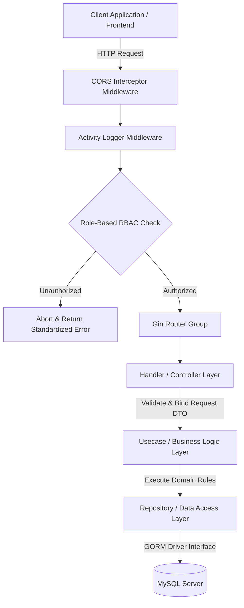

# 💼 WorkIt Backend Engine (WorkIt-BE)

[](https://golang.org)
[](https://github.com/gin-gonic/gin)
[](https://gorm.io)
[](https://www.mysql.com)
[](https://www.docker.com)
[](https://en.wikipedia.org/wiki/Multitier_architecture)

---

## 🌟 Executive Summary

**WorkIt Backend Engine** adalah sebuah RESTful API berkinerja tinggi, berskala *enterprise*, dan dirancang menggunakan pendekatan **Clean Architecture** berbasis bahasa Go (Golang). Sistem ini dikembangkan secara modular untuk menjamin *scalability*, *maintainability*, dan *decoupling* tingkat tinggi antar domain fungsional. 

Ditenagai oleh **Gin Web Framework** untuk manajemen routing dengan *low-latency* ekstrim, sistem ini mengintegrasikan **GORM** sebagai *Object-Relational Mapper* untuk interaksi database MySQL yang aman dan efisien, lengkap dengan proteksi keamanan terenkripsi dan sistem otorisasi berbasis peran (**Role-Based Access Control / RBAC**) yang tangguh.

Sistem ini didesain siap produksi (*production-ready*) dengan dukungan kontainerisasi penuh menggunakan Docker dan orkestrasi Docker Compose untuk menyederhanakan siklus *Continuous Integration & Continuous Deployment* (CI/CD).

---

## 🚀 Key Capabilities & Enterprise Features

Sistem ini dirancang untuk menyajikan kapabilitas tangguh tingkat tinggi demi memenuhi standar operasional Silicon Valley:

*   **Decoupled Architecture & SOLID Principles**: Mengadopsi pemisahan tanggung jawab (*Separation of Concerns*) secara ketat melalui struktur modular `Handler -> Usecase -> Repository` untuk performa arsitektur yang sangat teruji.
*   **Enterprise RBAC (Role-Based Access Control)**: Pembatasan akses *granular* dan aman di level *route* menggunakan middleware otorisasi JWT untuk membedakan peran `administrator` dan `user`.
*   **GORM Automatic Database Schema Migration**: Pengolahan skema database secara deklaratif dengan migrasi otomatis (*automigrate*) untuk integritas tabel data relasional secara *out-of-the-box*.
*   **Activity Logger & Diagnostics Pipeline**: Interseptor request global yang melacak metrik lalu lintas data, waktu eksekusi, serta jejak audit aktivitas klien secara *real-time*.
*   **Standardized JSON Serialization**: Struktur data respon terpadu yang memfasilitasi integrasi front-end yang mulus dengan format penanganan error terperinci (*response trace*) pada lingkungan non-produksi.
*   **Production-Grade Containerization**: Dilengkapi dengan Dockerfile multi-tahap (*multi-stage build*) berbasis Alpine Linux untuk meminimalkan ukuran *image footprint* produksi demi keamanan optimal.
*   **Pre-configured Local Cloud Development**: Orkestrasi instan menyertakan MySQL database server beserta antarmuka grafis phpMyAdmin yang siap dioperasikan dalam satu perintah.

---

## 📐 Software Architecture Blueprint

Sistem ini mengimplementasikan variasi dari **Clean Architecture** yang terbagi dalam beberapa lapisan logis untuk menjaga fleksibilitas penuh terhadap pergantian *framework* pihak ketiga:



### 📂 Directory Hierarchy & Blueprint

Struktur repositori diatur secara terstruktur guna mempermudah kolaborasi tim lintas divisi (*cross-functional engineering teams*):

```text
workit-be/
├── config/                 # Manajemen konfigurasi terpusat & koneksi database
│   ├── application.go      # Parsing & pemetaan variabel lingkungan aplikasi
│   ├── config.go           # Struktur entitas config global
│   └── database.go         # Inisialisasi GORM, pool koneksi, & otomatisasi migrasi skema
├── service/                # Gerbang HTTP API & Orkes Aliran Request
│   ├── extensions/         # Custom library helper, loggers, & model penanganan error
│   │   ├── helper/         # Utilitas pemrosesan tipe data
│   │   ├── logging/        # Pipeline pencatatan log
│   │   ├── rest/           # Helper komunikasi HTTP/REST
│   │   └── terror/         # Spesifikasi & standarisasi internal error model
│   ├── middlewares/        # Interseptor siklus hidup request (RBAC, Logging, CORS)
│   ├── modules/            # Modul domain modular (Clean Architecture)
│   │   ├── product/        # Domain Produk (Handler, Usecase, Repository)
│   │   └── user/           # Domain Pengguna & Otentikasi (Handler, Usecase, Repository)
│   └── service.go          # Registrasi rute router Gin & penyajian aset statis
├── types/                  # Entitas data global & konstanta yang dapat digunakan kembali
│   ├── constants/          # Nilai statis (nama ENV, representasi peran RBAC)
│   └── models/             # Schema tabel database GORM & DTO respon API
├── docker-compose.yml      # Orkestrasi infrastruktur development lokal (App, DB, Admin)
├── dockerfile              # Multi-stage Docker build untuk efisiensi rilis produksi
├── go.mod                  # Manifes modul dependensi Go
├── go.sum                  # Lockfile integritas dependensi
└── main.go                 # Titik masuk utama aplikasi (Application Bootstrap)
```

---

## 🛠️ Technological Infrastructure Stack

*   **Language Engine**: [Go (Golang) v1.20](https://golang.org) - Bahasa bertipe statis dengan kompilasi cepat dan performa konkurensi kelas dunia melalui Goroutines.
*   **Web Framework**: [Gin Gonic v1.9.1](https://github.com/gin-gonic/gin) - HTTP Router berkinerja tinggi yang memanfaatkan *custom version* dari HttpRouter dengan memori *footprint* minimal.
*   **Object Relational Mapper**: [GORM v1.25.5](https://gorm.io) - Driver ORM ramah pengembang untuk memfasilitasi transaksi database relasional yang aman dari SQL Injection.
*   **Database Engine**: [MySQL v8.0.28](https://www.mysql.com) - Database relasional andal untuk pemrosesan data transaksional yang konsisten (ACID compliant).
*   **Authentication Token**: [JWT (JSON Web Tokens)](https://github.com/dgrijalva/jwt-go) - Standar industri RFC 7519 untuk transmisi klaim identitas pengguna secara terenkripsi dan *stateless*.
*   **Data Processing Utility**: [Excelize v1.4.1](https://github.com/360EntSecGroup-Skylar/excelize) - Library manipulasi berkas spreadsheet tingkat lanjut untuk laporan data.

---

## 🗄️ Database Architecture & Schemas

GORM secara otomatis mengelola struktur tabel berikut berdasarkan deklarasi model pada inisialisasi awal. Setiap tabel menyematkan entitas standar `DbStandard` (meliputi kolom `id`, `created_at`, `updated_at`, dan pencatatan soft delete `deleted_at`).

### 1. Tabel: `users`
Menyimpan informasi identitas pengguna sistem.

| Kolom Nama | Tipe Data | Atribut GORM | Deskripsi |
| :--- | :--- | :--- | :--- |
| `id` | `uint` | `primarykey` | Identifier unik (auto-increment). |
| `created_at` | `datetime` | | Tanggal pembuatan entitas. |
| `updated_at` | `datetime` | | Tanggal pembaharuan terakhir. |
| `deleted_at` | `datetime` | `index` | Timestamp untuk *Soft Delete*. |
| `name` | `varchar(255)` | `binding:"required"` | Nama lengkap pengguna. |
| `email` | `varchar(255)` | `unique; binding:"required"` | Alamat email unik (hanya diatur saat pembuatan). |
| `phone` | `varchar(20)` | `unique; binding:"required"` | Nomor telepon seluler unik. |
| `password` | `varchar(255)` | `binding:"required"` | Hash kata sandi terenkripsi (bcrypt). |
| `role_id` | `bigint` | `column:role_id` | Foreign Key yang terasosiasi ke tabel `roles`. |

### 2. Tabel: `roles`
Mendefinisikan peran hak akses di dalam sistem (misal: `administrator`, `user`).

| Kolom Nama | Tipe Data | Atribut GORM | Deskripsi |
| :--- | :--- | :--- | :--- |
| `id` | `uint` | `primarykey` | Identifier unik peran. |
| `name` | `varchar(100)` | | Nama peran (e.g., `administrator`, `user`). |

### 3. Tabel: `products`
Menyimpan data katalog persediaan komoditas barang.

| Kolom Nama | Tipe Data | Atribut GORM | Deskripsi |
| :--- | :--- | :--- | :--- |
| `id` | `uint` | `primarykey` | Identifier unik produk. |
| `name` | `varchar(255)` | `binding:"required"` | Nama produk dagang. |
| `description` | `text` | `binding:"required"` | Uraian informasi spesifikasi barang. |
| `price` | `double` | `binding:"required"` | Nominal harga jual produk. |
| `quantity` | `double` | `binding:"required"` | Ketersediaan kuantitas stok barang. |

---

## 🔌 API Reference Guide

Semua interaksi API menggunakan format JSON sebagai payload request dan response body. Endpoint terbagi atas versi API `/api/v1`.

### 🔐 User & Authentication Module

#### A. Otentikasi Pengguna & Pendaftaran

##### **1. Membuat Akun Pengguna Baru (Registrasi)**
*   **Path**: `/api/v1/user/create`
*   **Method**: `POST`
*   **Tingkat Keamanan**: Terbuka Publik (`ROLES_NOAUTH`)
*   **Payload Request Body**:
    ```json
    {
      "name": "Jane Doe",
      "email": "jane.doe@workit.com",
      "phone": "+628123456789",
      "password": "SuperSecretSecurePassword123!",
      "role_id": 2
    }
    ```
*   **Skema Response Sukses (200 OK)**:
    ```json
    {
      "responseCode": "00",
      "responseDesc": "Success",
      "responseData": {
        "id": 12,
        "name": "Jane Doe",
        "email": "jane.doe@workit.com",
        "phone": "+628123456789",
        "role_id": 2,
        "created_at": "2026-05-18T21:50:00Z"
      }
    }
    ```

##### **2. Login Akun (Memperoleh Token Sesi)**
*   **Path**: `/api/v1/user/login`
*   **Method**: `POST`
*   **Tingkat Keamanan**: Terbuka Publik (`ROLES_NOAUTH`)
*   **Payload Request Body**:
    ```json
    {
      "email": "jane.doe@workit.com",
      "password": "SuperSecretSecurePassword123!"
    }
    ```
*   **Skema Response Sukses (200 OK)**:
    ```json
    {
      "responseCode": "00",
      "responseDesc": "Success",
      "responseData": {
        "token": "eyJhbGciOiJIUzI1NiIsInR5cCI6IkpXVCJ9.eyJzdWIiOiIxMiIsImV4cCI6MTc4MDAwMDAwMH0.signature..."
      }
    }
    ```

#### B. Administrasi Pengguna (Khusus Administrator)

##### **3. Perbaharui Data Pengguna**
*   **Path**: `/api/v1/user/edit`
*   **Method**: `PUT`
*   **Tingkat Keamanan**: Diperlukan Token Bearer & Hak Akses `administrator`
*   **Payload Request Body**:
    ```json
    {
      "id": 12,
      "name": "Jane Doe Corporate",
      "phone": "+62899999999",
      "role_id": 2
    }
    ```

##### **4. Ambil Detail Pengguna Berdasarkan ID**
*   **Path**: `/api/v1/user/detail/:id`
*   **Method**: `GET`
*   **Tingkat Keamanan**: Diperlukan Token Bearer & Hak Akses `administrator`

##### **5. Pencarian Pengguna dengan Filter Kompleks**
*   **Path**: `/api/v1/user/search`
*   **Method**: `POST`
*   **Tingkat Keamanan**: Diperlukan Token Bearer & Hak Akses `administrator`
*   **Payload Request Body**:
    ```json
    {
      "limit": 10,
      "page": 1,
      "orders": ["created_at desc"],
      "data": {
        "name": "Jane"
      }
    }
    ```

#### C. Informasi Profil (Dapat Diakses `administrator` & `user`)

##### **6. Mengambil Sesi Pengguna Aktif**
*   **Path**: `/api/v1/user/session`
*   **Method**: `GET`
*   **Tingkat Keamanan**: Diperlukan Token Bearer (`administrator` ATAU `user`)

##### **7. Ambil Informasi Pengguna Berdasarkan Email**
*   **Path**: `/api/v1/user/get-by-email`
*   **Method**: `POST`
*   **Payload Request Body**:
    ```json
    {
      "email": "jane.doe@workit.com"
    }
    ```

##### **8. List Seluruh Data Pengguna**
*   **Path**: `/api/v1/user/list-user`
*   **Method**: `POST`

---

### 📦 Product Module

#### **1. Menambahkan Katalog Produk Baru**
*   **Path**: `/api/v1/products/create`
*   **Method**: `POST`
*   **Tingkat Keamanan**: Terbuka Publik (`ROLES_NOAUTH` / Dapat diintegrasikan dengan proteksi RBAC)
*   **Payload Request Body**:
    ```json
    {
      "name": "WorkIt Ergonomic Chair Elite Edition",
      "description": "Kursi ergonomis premium dengan penyangga lumbar adaptif 3D tingkat lanjut.",
      "price": 3499000.00,
      "quantity": 150
    }
    ```
*   **Skema Response Sukses (200 OK)**:
    ```json
    {
      "responseCode": "00",
      "responseDesc": "Success",
      "responseData": {
        "id": 5,
        "name": "WorkIt Ergonomic Chair Elite Edition",
        "description": "Kursi ergonomis premium dengan penyangga lumbar adaptif 3D tingkat lanjut.",
        "price": 3499000.00,
        "quantity": 150,
        "created_at": "2026-05-18T21:50:00Z"
      }
    }
    ```

#### **2. Menampilkan Seluruh Katalog Produk**
*   **Path**: `/api/v1/products/getlist`
*   **Method**: `GET`
*   **Tingkat Keamanan**: Terbuka Publik (`ROLES_NOAUTH`)
*   **Skema Response Sukses (200 OK)**:
    ```json
    {
      "responseCode": "00",
      "responseDesc": "Success",
      "responseData": [
        {
          "id": 5,
          "name": "WorkIt Ergonomic Chair Elite Edition",
          "description": "Kursi ergonomis premium dengan penyangga lumbar adaptif 3D tingkat lanjut.",
          "price": 3499000.00,
          "quantity": 150,
          "created_at": "2026-05-18T21:50:00Z"
        }
      ]
    }
    ```

---

## ⚙️ Environment Configurations (`.env`)

Aplikasi mengandalkan variabel lingkungan untuk memisahkan konfigurasi operasional dari basis kode inti. Sebelum menjalankan aplikasi, buat salinan berkas `.env` dari spesifikasi berikut:

```env
# 💻 Konfigurasi Runtime Aplikasi
APP_NAME="WorkIt Backend Service"
APP_HOST="0.0.0.0"
APP_PORT="8080"
APP_SECRET="Masukkan_String_Kunci_Rahasia_JWT_Silicon_Valley_Anda_Disini"
APP_ENV="local"            # Pilihan Nilai: local | staging | production
APP_MAX_ROWS_DATA=50       # Batas default query baris data untuk pagination

# 🗄️ Kredensial Database MySQL
DB_DRIVER="mysql"
DB_HOST="127.0.0.1"        # Ubah ke 'database' jika berjalan di dalam container Docker Compose
DB_PORT="3345"             # Port yang dipetakan oleh docker-compose (internal: 3306)
DB_NAME="workit_db"
DB_USER="workit_user"
DB_PASSWORD="WorkItStrongSecurePassword2026!"
DB_IS_LOGGED=true          # Mengaktifkan debug query log database di console

# 🛠️ Port Manajemen Database Eksternal (Hanya untuk Docker Compose)
PHPMYADMIN_PORT=8082
```

---

## 🏁 Local Quickstart & Execution Guide

### Prasyarat Awal (Prerequisites)
Pastikan lingkungan pengembangan lokal Anda telah terpasang:
*   [Golang SDK (v1.20 atau lebih baru)](https://golang.org/dl/)
*   [Docker Desktop](https://www.docker.com/products/docker-desktop/) & Engine Docker Compose
*   Client untuk pengujian HTTP (seperti Postman, Insomnia, atau Thunder Client)

### Opsi A: Eksekusi Menggunakan Docker Compose (Direkomendasikan 🐳)

Orkestrasi Docker Compose akan secara otomatis mempersiapkan container MySQL Database, instansi aplikasi Go, dan panel visual phpMyAdmin dalam satu jaringan terisolasi.

1.  **Clone Repositori dan Masuk ke Direktori Kerja**:
    ```bash
    git clone https://github.com/ricnah/workit-be.git
    cd workit-be
    ```

2.  **Konfigurasi File Environment**:
    Buat berkas `.env` di root direktori dengan menyalin dari bagian konfigurasi di atas. Sesuaikan nilai `DB_HOST` menjadi `database` agar aplikasi dalam container dapat terhubung dengan MySQL container:
    ```env
    DB_HOST=database
    DB_PORT=3306
    ```

3.  **Jalankan Infrastruktur Container**:
    ```bash
    docker-compose up --build -d
    ```
    *Bendera `-d` menjalankan container di latar belakang (detached mode).*

4.  **Verifikasi Status Container**:
    ```bash
    docker-compose ps
    ```

5.  **Akses Antarmuka**:
    *   **Backend Engine API**: [http://localhost:8066/api/v1](http://localhost:8066/api/v1)
    *   **phpMyAdmin Console**: [http://localhost:8082](http://localhost:8082) (Kredensial sesuai dengan `.env`)

6.  **Menghentikan Container**:
    ```bash
    docker-compose down -v
    ```
    *Bendera `-v` akan membersihkan volume data database jika Anda ingin mereset state dari awal.*

---

### Opsi B: Kompilasi & Eksekusi Secara Lokal (Native Development 💻)

1.  **Unduh Dependensi Pihak Ketiga**:
    ```bash
    go mod download
    ```

2.  **Pastikan Server Database Aktif**:
    Pastikan Anda memiliki database MySQL yang berjalan di port `3345` (atau port MySQL bawaan laptop Anda `3306`) sesuai konfigurasi `.env`.

3.  **Jalankan Proses Bootstrap**:
    ```bash
    go run main.go
    ```
    *Sistem akan memuat berkas `.env`, menghubungkan ke database, memicu `AutoMigrate` untuk membuat tabel secara otomatis, dan memulai server HTTP di alamat `http://0.0.0.0:8080`.*

4.  **Kompilasi ke Binary Executable (Production Build)**:
    ```bash
    go build -o workit-engine .
    ./workit-engine
    ```

---

## 🛡️ Production Deployment & Scaling Best Practices

Untuk merilis layanan API ini di lingkungan cloud komersial (seperti AWS, Google Cloud Platform, atau Heroku), perhatikan poin-poin standar industri berikut:

### 1. Kompilasi Docker Multi-Stage (Multi-Stage Build)
Aplikasi ini sudah mendukung Dockerfile multi-stage untuk memastikan keamanan tinggi. Proses ini memisahkan proses kompilasi kode dari *runtime binary image*:
*   **Tahap Build**: Menggunakan image `golang:1.20-alpine` untuk melakukan resolusi dependensi dan mengompilasi binary statis yang teroptimasi tanpa menyertakan compiler.
*   **Tahap Final**: Menyalin *compiled binary* eksklusif ke dalam image minimal `alpine:latest` yang terisolasi. Ini menghasilkan ukuran container yang sangat kecil (~30MB) dan menghilangkan area celah keamanan permukaan eksploitasi (*attack surface area*).

### 2. Peningkatan Keamanan Produksi
*   **Ubah Modus Operasional Aplikasi**: Selalu ubah nilai `APP_ENV` ke `production` pada konfigurasi berkas `.env`. Ini secara otomatis mematikan visualisasi deteksi jejak error internal (`ResponseTrace`) pada client untuk mencegah kebocoran informasi sistem sensitif (*information leakage*).
*   **Rotasi Kunci Rahasia**: Gunakan kunci enkripsi yang kuat dan dirotasi berkala untuk variabel `APP_SECRET`. Gunakan modul AWS Secrets Manager atau GCP Secret Manager.
*   **Matikan Port DB Terbuka**: Pada produksi, jangan pernah membuka port database (misal `3306`/`3345`) ke jaringan luar. Batasi koneksi database MySQL hanya dari host atau alamat VPC internal container API Anda berjalan.

### 3. Skalabilitas Horisontal & Stateless Session
Karena otentikasi user menggunakan **stateless JWT**, kontainer aplikasi `golang-app` dapat diskalakan secara horisontal (*horizontal scaling*) menjadi beberapa replika di belakang Load Balancer (seperti NGINX, AWS ALB, atau Cloudflare) tanpa khawatir kehilangan sesi aktif pengguna.

---

## 🤝 Code Contributions & Standards

Proyek ini mempertahankan standar kualitas kode yang sangat ketat:
*   Semua alur bisnis baru wajib memiliki implementasi modular dengan pola *Clean Architecture*.
*   Gunakan penanganan error terpusat memanfaatkan modul custom `service/extensions/terror`.
*   Semua perubahan file rute harus didefinisikan dengan menyertakan tag tipe data binding Gin untuk pencegahan anomali data masukan.

Untuk berkontribusi, harap buat *pull request* dengan spesifikasi nama branch deskriptif (misal: `feature/user-oauth-integration` atau `bugfix/connection-leak`).

---

*Developed by Team. Managed under Enterprise Software Design Guidelines.*
